# GreetKit

[](https://github.com/hksw-io/GreetKit/actions/workflows/ci.yml)

A reusable SwiftUI welcome sheet for iOS and macOS apps in the HK Softworks portfolio.

Pure SwiftUI — the consumer owns state (loading, error, dismissal). Works with any state management approach (TCA, `@Observable`, `@State`).

The package and import name is `GreetKit`. Public view and content APIs intentionally use the
domain language `Greet...`, for example `GreetView`, `GreetContent`, and
`GreetPrimaryRoute`.

## Preview

<p>
  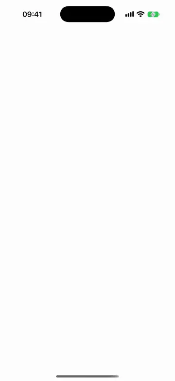
</p>

The welcome sheet on iPhone, then Get started opening a two-step setup route chain with the back
chevron and a Finish button on the last step.

<p>
  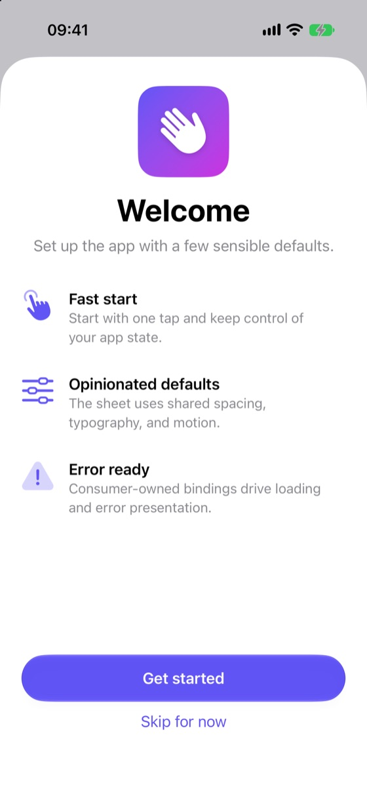
  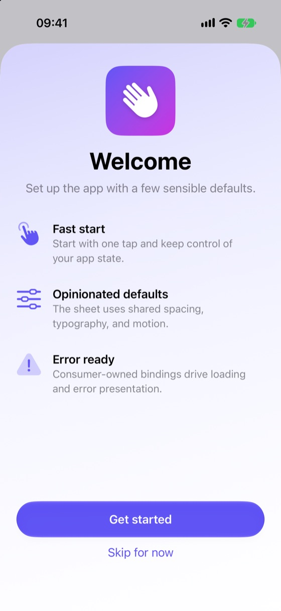
  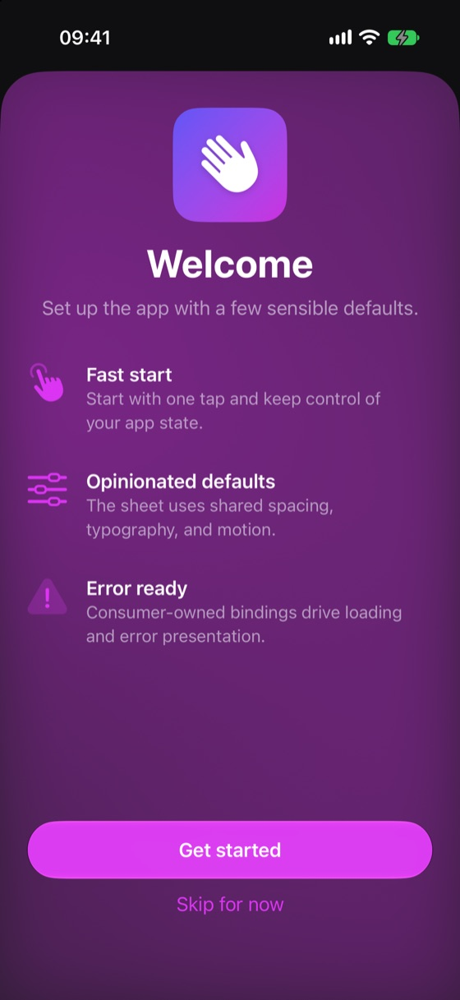
</p>

Left to right: the default `.system` background, `.softGradient`, and `.animatedGradient` in dark
mode. All three are the same sheet with one modifier changed.

### iPad and macOS

<p>
  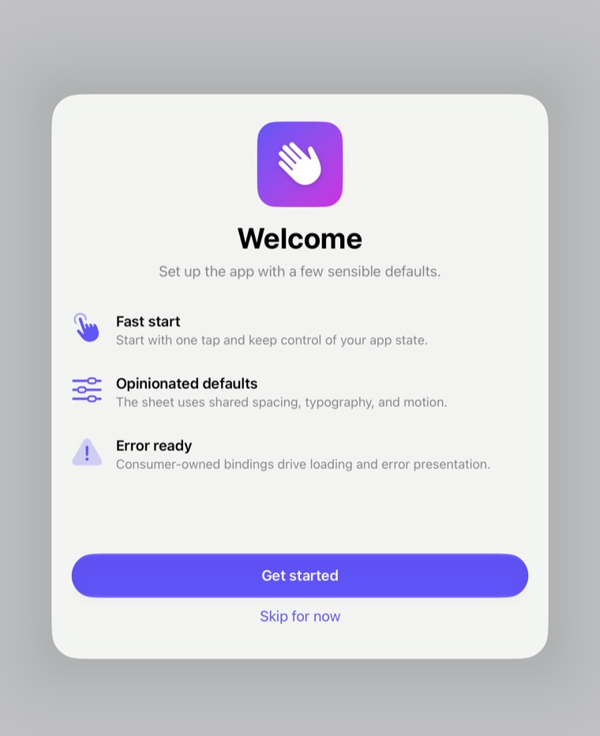
  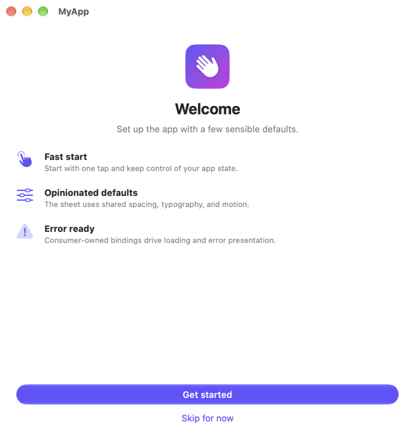
  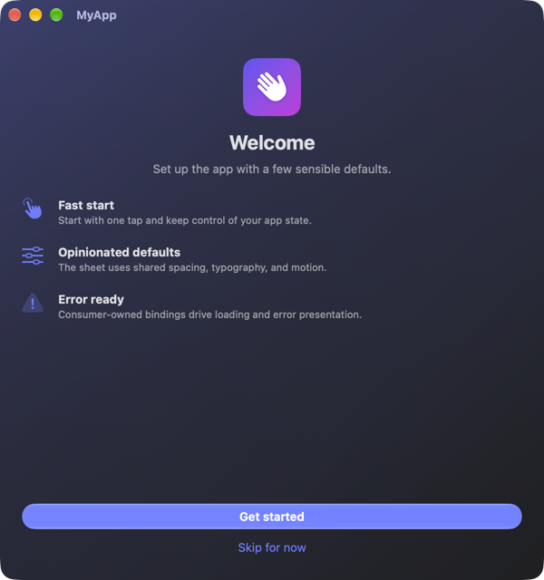
</p>

On iPad the sheet is a form sheet and the content stays at a readable width rather than stretching.
On macOS the view carries window proportions instead of phone ones, and the icon, type, spacing, and
reveal travel are all scaled for the desktop.

## Requirements

- iOS 26+ / macOS 26+
- Swift 6.2+

## Installation

```swift
.package(url: "https://github.com/hksw-io/GreetKit.git", from: "3.1.0")
```

Or in Xcode: **File > Add Package Dependencies**, enter the URL above, and choose **Up to Next Major Version** from `3.1.0`.

See [CHANGELOG.md](CHANGELOG.md) for what changed between releases.

## Usage

Implement `GreetContent` with your app's strings and icon, then drive the view with bindings and callbacks:

```swift
import SwiftUI
import GreetKit

struct MyGreet: GreetContent {
    var appIcon: Image? { Image("AppIconImage") }
    var title: Text { Text("Welcome to MyApp") }
    var subtitle: Text? { Text("Here's what makes it great.") }
    var features: [GreetFeatureItem] {
        [
            GreetFeatureItem(
                id: "tap-to-flip",
                systemImage: "hand.tap.fill",
                label: "Tap to flip",
                description: "Review cards with a simple tap."),
        ]
    }
    var primaryRoutes: [GreetPrimaryRoute] {
        [
            GreetPrimaryRoute(id: "permissions"),
            GreetPrimaryRoute(id: "sample-data"),
            GreetPrimaryRoute(id: "notifications"),
        ]
    }
    var footnote: Text? { Text("You can change these choices later in Settings.") }
    var primaryButtonText: Text { Text("Get started") }
    var primaryRouteNextButtonText: Text { Text("Next") }
    var primaryRouteBackButtonText: Text { Text("Back") }
    var primaryRouteDoneButtonText: Text { Text("Finish") }
    var skipButtonText: Text? { Text("Skip for now") }
    var errorAlertTitle: Text { Text("Something went wrong") }
    var errorOKText: Text { Text("OK") }
}

struct RootView: View {
    @State private var isLoading = false
    @State private var errorMessage: String?

    var body: some View {
        GreetView(
            content: MyGreet(),
            isLoading: $isLoading,
            errorMessage: $errorMessage,
            onPrimary: { /* analytics or setup before routes open */ },
            onSkip: { /* mark first-run flow complete, dismiss */ },
            onPrimaryRoutesComplete: {
                /* dismiss the welcome flow or mark setup complete */
            },
            primaryRouteDestination: { route in
                switch route.id {
                case "permissions":
                    PermissionsSetupView()
                case "sample-data":
                    SampleDataSetupView()
                case "notifications":
                    NotificationSetupView()
                default:
                    EmptyView()
                }
            })
    }
}
```

Required: `title`, `features`, `primaryButtonText`, `errorAlertTitle`, and `errorOKText`.
Everything else has a default: `appIcon`, `subtitle`, `skipButtonText`, and `footnote` default to
`nil`, `primaryRoutes` to `[]`, and the route and loading strings to English.

On macOS the overview and every route carry a 480×420 pt minimum and a 560×520 pt ideal size, so
a sheet opens at Mac proportions and does not resize as the flow moves between steps. To present
it larger, set a sizing on the presentation; nothing can go below the minimum:

```swift
.sheet(isPresented: $showingGreet) {
    GreetView(...)
        .presentationSizing(.page)
}
```

For a simple welcome sheet, omit `primaryRoutes` and `primaryRouteDestination`. The primary and skip callbacks can then dismiss the sheet directly. Without `primaryRouteDestination`, `primaryRoutes` is ignored and the primary button only calls `onPrimary`.

`footnote` adds a sentence in secondary footnote type directly above the primary button on the
overview, for when the actions need explaining. Route pages do not show it.

<p>
  
  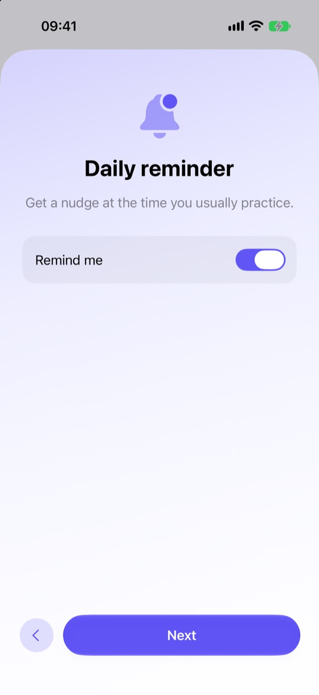
</p>

A footnote on the overview, and the first page of a route chain with its back chevron and Next button.

For a setup flow, provide `primaryRoutes` and `primaryRouteDestination`. `onPrimary` fires first, then the library opens the first route with an in-sheet transition. Do not dismiss from `onPrimary` when using routes. Finish in `onPrimaryRoutesComplete` after the last route. `primaryRouteNextButtonText` and `primaryRouteDoneButtonText` customize the route controls. A single follow-up step is a chain of one — the button reads Done and the route completes the flow.

`isLoading` also disables Back, Next, and Done and shows progress on the active route. If completion
starts asynchronous work, set `isLoading = true` synchronously in `onPrimaryRoutesComplete`,
then dismiss from the consumer after success. On failure, set `errorMessage` and clear loading;
the final route stays available for retry. A synchronous completion with no loading or error
returns to the overview as before.

The back chevron revisits the previous route, or the overview from the first route. Command-[ provides the
same action with a keyboard. Keep destination form values in your app's state so they survive
navigation. `primaryRouteBackButtonText` supplies its accessible name and pointer help; the
visible control is an icon. Override it along with Next, Done, and the loading
accessibility value for your app's locale. VoiceOver focus moves into each destination and
returns to the welcome title when the overview reappears.

GreetKit does not include a separate "next steps" card/list primitive. If the primary button should continue into setup, model that as a route chain; if the app needs additional cards, build them in the consuming app or in the destination views.

## Backgrounds

The default background is the system sheet surface. Use `greetBackground(_:)` when an app needs a more branded first-run experience:

```swift
GreetView(
    content: MyGreet(),
    isLoading: $isLoading,
    errorMessage: $errorMessage,
    onPrimary: {},
    onSkip: {})
    .greetBackground(.animatedGradient())
    .greetStyle(GreetStyle(tint: .indigo))
```

`greetBackground(_:)` and `greetStyle(_:)` are methods on `GreetView`, so apply them directly to it, before any other modifier.

Built-in options:

- `.system` — the default. Draws nothing, so the presentation's own surface shows through: a sheet keeps the material the platform gives it.
- `.softGradient` / `.softGradient(brand:)` — a restrained brand-derived background tuned for readable first-run content.
- `.animatedGradient(brand:motion:)` — an opt-in smooth full-surface animated gradient. It uses the style tint by default, adapts its tones for light and dark mode, and automatically becomes static when Reduce Motion is enabled.
- `.custom { context in ... }` — a fully custom SwiftUI background, including a plain `LinearGradient` of your own colors. Use `context.reduceMotion`, `context.reduceTransparency`, `context.colorSchemeContrast`, `context.brandColor`, and `context.colorScheme` to keep custom backgrounds consistent and accessible.

```swift
.greetBackground(.custom { _ in
    LinearGradient(
        colors: [.blue.opacity(0.18), .mint.opacity(0.12), .clear],
        startPoint: .topLeading,
        endPoint: .bottomTrailing)
})
```

Destination views can still draw their own backgrounds. If they do, that local destination background appears above the GreetKit background.

Every background is drawn edge to edge: behind the pinned footer and, in a full-screen presentation, through the safe areas to the screen edges. Scroll indicators are hidden on iOS, where a swipe and the fade above the footer already say the content continues, and left to the system on macOS, where the scroller is how a window tells you there is more below. The setting applies to route destinations too; a destination that wants iOS indicators sets `.scrollIndicators(_:)` itself.

`GreetStyle.tint` is the default brand color for `.softGradient` and `.animatedGradient()`. With neither `brand:` nor a tint, the built-in gradients fall back to `.blue`; they cannot read the app's accent color. In `.custom`, `context.brandColor` is the style tint and is `nil` when none is set. Pass `brand:` when the background should use a different brand color from the controls:

```swift
GreetView(
    content: MyGreet(),
    isLoading: $isLoading,
    errorMessage: $errorMessage,
    onPrimary: {},
    onSkip: {})
    .greetBackground(.animatedGradient(brand: .pink))
```

The supporting tones are derived from that one color — washed toward the platform surface, which lifts them in light mode and deepens them in dark. An app that needs exact control over every tone should use `.custom { context in ... }` and draw the gradient itself.

<p>
  
  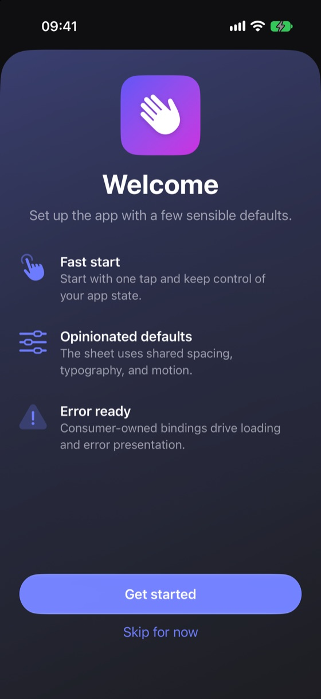
</p>

The same `.softGradient` and the same brand color in both schemes.

Use `motion:` when the default dancing gradient should be calmer or more expressive:

```swift
GreetView(
    content: MyGreet(),
    isLoading: $isLoading,
    errorMessage: $errorMessage,
    onPrimary: {},
    onSkip: {})
    .greetBackground(.animatedGradient(motion: .expressive))
```

The built-in presets are `.subtle` (0.7), `.standard` (1.2, the default), and `.expressive` (1.6). Stronger motion moves the color field farther and faster; it does not change the colors, opacities, or blur, so choosing a calmer pace never means a paler sheet. For finer control, pass `GreetGradientMotion(strength:)`; values are clamped from `0` to `2`, and `0` keeps the animated-gradient color field static.

GreetKit pins the footer with `safeAreaBar(edge:)` and fades overflowing content out just above it. The platform's scroll edge effect is hidden there: its hard style draws a dividing line even when nothing scrolls under the footer, and its soft style lets text run under the footer's own text. Route pages pin Back and Next/Done the same way, but a scrolling destination keeps the platform's default scroll edge effect.

## Styling

Use `greetStyle(_:)` to set the brand color while keeping the library's layout, typography, and motion:

```swift
GreetView(
    content: MyGreet(),
    isLoading: $isLoading,
    errorMessage: $errorMessage,
    onPrimary: {},
    onSkip: {})
    .greetBackground(.softGradient)
    .greetStyle(GreetStyle(tint: .indigo))
```

`GreetBackground` controls the surface behind the sheet content. `GreetStyle` carries the brand color: the view applies it with `.tint`, so the prominent glass button, the skip action, the route back button, and the feature icons take it from the environment, and the built-in gradients derive their palette from it. Leave it `nil` for the system accent.

Text roles are deliberately not overridable. Title, subtitle, feature rows, and the footnote use the system label hierarchy; the skip action is body text in the tint color, and the primary button is the system prominent glass button — so the platform supplies the pressed, hovered, focused, disabled, and Increase Contrast treatments, and picks a label color legible against your tint. If an app needs a fully bespoke surface, use `.custom { context in ... }` for the background and style the destination views it owns.

## State ownership

The view is purely presentational:

- Give every `GreetFeatureItem` and `GreetPrimaryRoute` a stable `id`. These IDs preserve SwiftUI identity and are used for routing and analytics.
- `isLoading: Binding<Bool>` — when `true`, the primary button shows a progress spinner and both buttons are disabled (below, right).
- `errorMessage: Binding<String?>` — when non-nil, the view presents an alert. Setting it back to `nil` (or letting the user tap the OK button) dismisses the alert.
- `allowsInteractiveDismissal` — defaults to `true`. Set it to `false` only for setup flows that must block swipe or window dismissal.
- `onPrimary` / `onSkip` — fired on tap. Your state layer handles the rest.
- `primaryRoutes` / `primaryRouteDestination` — optional chained follow-up routes opened by the primary button with in-sheet slide transitions. The package supplies customizable Next and Done controls. For a single follow-up step, give `primaryRoutes` one route.

<p>
  
  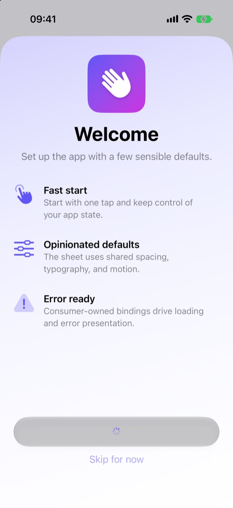
</p>

Route navigation state is intentionally transient and owned inside `GreetView`; persist only completed setup state in your app. Destination builders are generic at the public API and type-erased internally so call sites can return different SwiftUI views without exposing that plumbing.

`GreetFeatureItem` has `Text` and `LocalizedStringResource` initializers. Both require an explicit `id`, because `features` is normally a computed property and a generated identity would change on every evaluation. Use the `Text` initializer, `init(id:image:label:description:)`, for asset images; the `LocalizedStringResource` one takes an SF Symbol name.

## Accessibility

The library ships no localizations. Four `GreetContent` members fall back to English — `primaryRouteNextButtonText` ("Next"), `primaryRouteBackButtonText` ("Back"), `primaryRouteDoneButtonText` ("Done"), and `primaryButtonLoadingAccessibilityValue` ("Loading") — so override them for any other locale. While `isLoading` is `true` the primary button announces `primaryButtonLoadingAccessibilityValue`:

```swift
var primaryButtonLoadingAccessibilityValue: Text {
    Text(String(localized: "onboarding.action.loading"))
}
```

Feature icons and the app icon are hidden from VoiceOver; feature labels carry the header trait and read separately from their descriptions. Reduce Motion removes the feature reveal animation, the route slide transitions, and the animated gradient's movement.

<p>
  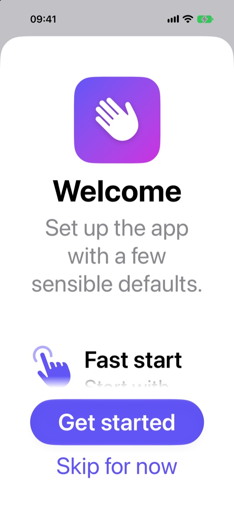
</p>

Every text role scales with Dynamic Type, and the icons, spacing, and content padding scale with it
through `@ScaledMetric`. At accessibility sizes the content scrolls and fades out above the pinned
footer rather than compressing, so the primary and skip buttons stay reachable at any type size.

The built-in gradient backgrounds flatten themselves under Reduce Transparency or Increase Contrast: the color wash is damped and more of the opaque base shows, so text contrast no longer depends on where a gradient blob happens to sit. Custom backgrounds get the same signals through `GreetBackgroundContext`.

Return triggers the primary action, including Next and Done inside a route chain. Escape triggers the skip action, but only when `skipButtonText` is non-nil and `allowsInteractiveDismissal` is `true` — a blocking setup flow stays blocked, and Escape never fires `onSkip` when there is no skip button on screen. Inside a route Escape is unbound; Command-[ goes back.

## Local development

Run the package tests from the package root:

```sh
swift test
```

The iOS build path is not covered by `swift test`, so check it too when touching platform-conditional code:

```sh
xcodebuild -scheme GreetKit -destination 'generic/platform=iOS' build
```

CI runs `swift test` and the test suite on an iOS Simulator (`xcodebuild test`) with Xcode 26.6
and 27.0, on every push to `master` and every pull request.

The README media was captured from the iOS 27.2 Simulator (iPhone 17 Pro, iPad Pro 11-inch)
and a macOS window.

## OS 27 compatibility

The deployment minimum remains iOS 26 / macOS 26, with Swift tools 6.2. CI runs package tests
on macOS and iOS Simulator with Xcode 26.6 and the Xcode 27.0 preview image. Each job selects
its toolchain and runtime generation explicitly; the 27 image is maintained by GitHub as
[`xcode-27`](https://github.com/actions/runner-images/issues/14404). New SDK-only APIs must
preserve the existing deployment and compiler minimums. Local SDK 27.2 validation complements
these jobs; a local pass does not establish the result of a hosted CI run.

## License

MIT. See [LICENSE](LICENSE).
