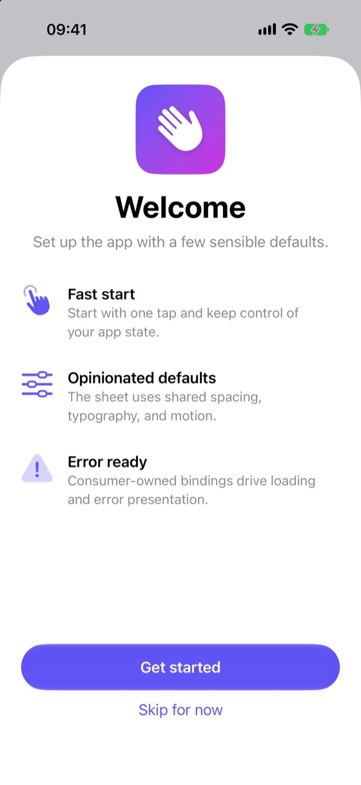
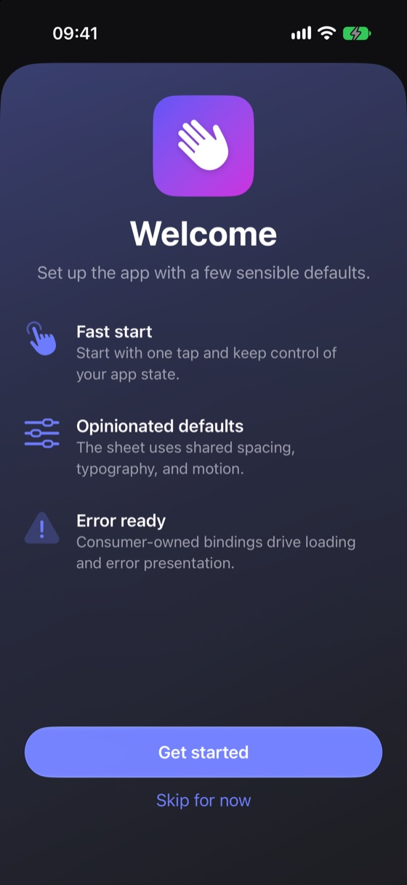
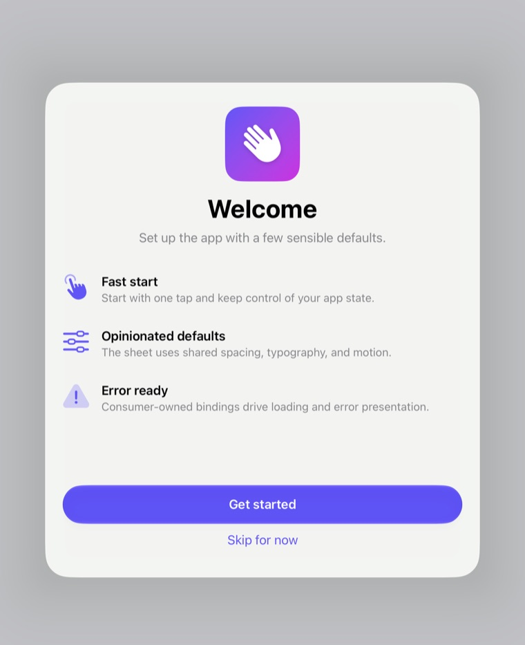
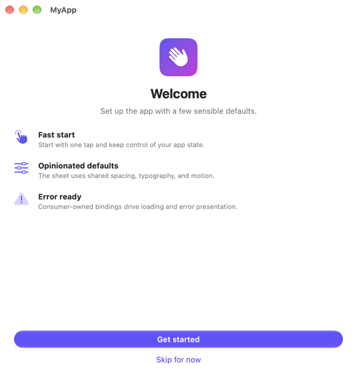
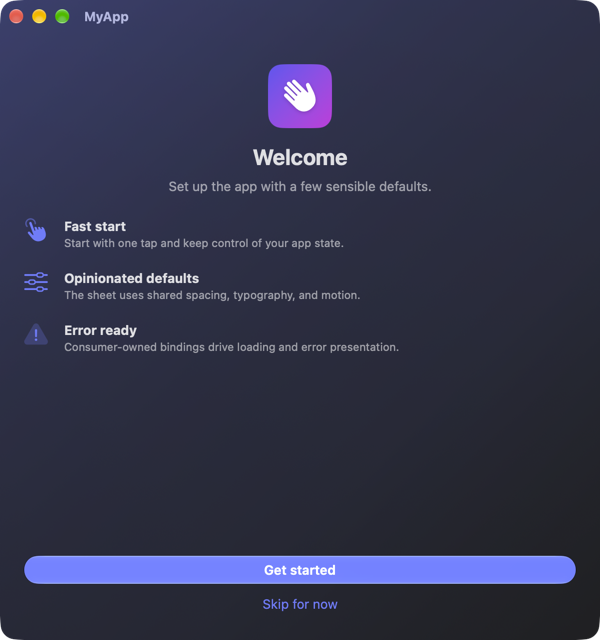
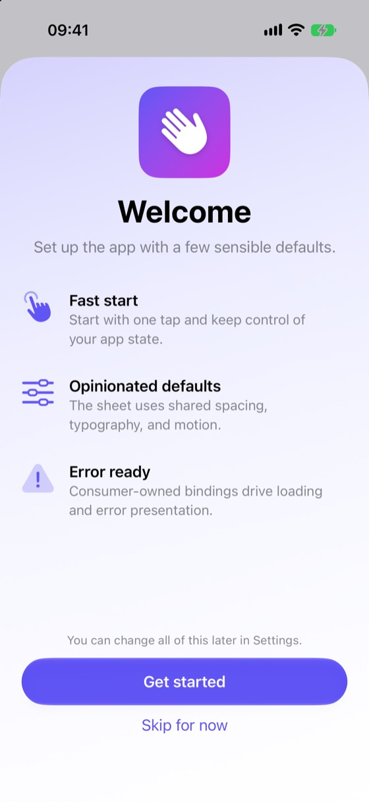
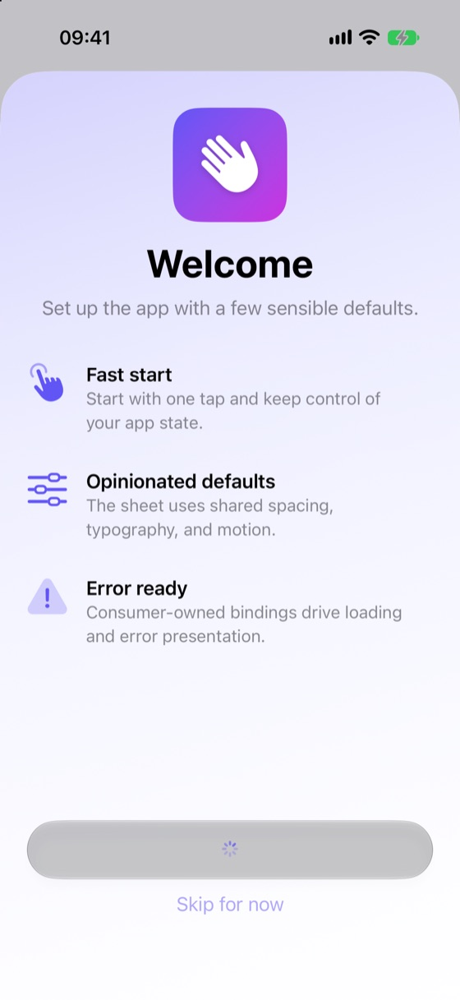
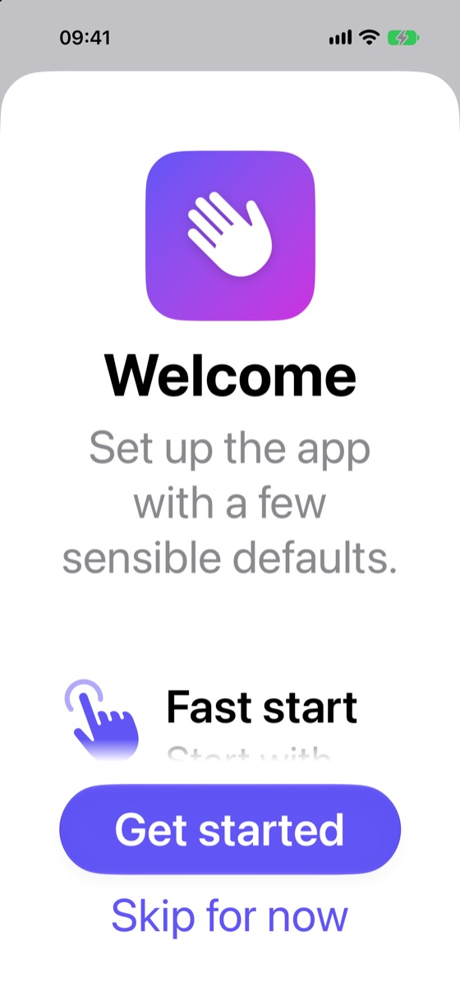

# GreetKit

[](https://github.com/hksw-io/GreetKit/actions/workflows/ci.yml)

A reusable SwiftUI welcome sheet for iOS and macOS apps in the HK Softworks portfolio.

Pure SwiftUI — the consumer owns state (loading, error, dismissal). Works with any state management approach (TCA, `@Observable`, `@State`).

The package and import name is `GreetKit`. Public view and content APIs intentionally use the
domain language `Greet...`, for example `GreetView`, `GreetContent`, and
`GreetPage`.

## Preview

<p>
  
  
  
</p>

Left to right: the default `.system` background, then `.softGradient` in light and dark mode. All
three are the same sheet with one modifier changed.

### iPad and macOS

<p>
  
  
  
</p>

On iPad the sheet is a form sheet and the content stays at a readable width rather than stretching.
On macOS the view carries window proportions instead of phone ones, and the icon, type, spacing, and
reveal travel are all scaled for the desktop.

## Requirements

- iOS 26+ / macOS 26+
- Swift 6.2+

## Installation

```swift
.package(url: "https://github.com/hksw-io/GreetKit.git", from: "3.1.0")
```

Or in Xcode: **File > Add Package Dependencies**, enter the URL above, and choose **Up to Next Major Version** from `3.1.0`.

See [CHANGELOG.md](CHANGELOG.md) for what changed between releases.

## Usage

Implement `GreetContent` with your app's strings and icon, then drive the view with state and callbacks:

```swift
import SwiftUI
import GreetKit

struct MyGreet: GreetContent {
    var appIcon: Image? { Image("AppIconImage") }
    var title: Text { Text("Welcome to MyApp") }
    var subtitle: Text? { Text("Here's what makes it great.") }
    var features: [GreetFeatureItem] {
        [
            GreetFeatureItem(
                id: "tap-to-flip",
                systemImage: "hand.tap.fill",
                label: "Tap to flip",
                description: "Review cards with a simple tap."),
        ]
    }
    var footnote: Text? { Text("You can change these choices later in Settings.") }
    var primaryButtonText: Text { Text("Get started") }
    var primaryButtonLoadingAccessibilityValue: Text { Text("Loading") }
    var skipButtonText: Text? { Text("Skip for now") }
    var errorAlertTitle: Text { Text("Something went wrong") }
    var errorOKText: Text { Text("OK") }
}

struct RootView: View {
    @State private var isLoading = false
    @State private var errorMessage: String?

    var body: some View {
        GreetView(
            content: MyGreet(),
            isLoading: isLoading,
            errorMessage: $errorMessage,
            onPrimary: { /* start setup, or mark the welcome seen and dismiss */ },
            onSkip: { /* mark the welcome seen and dismiss */ })
    }
}
```

Only `content` and `onPrimary` are required. An app with no loading state, no error to show and no
skip button leaves the rest out:

```swift
GreetView(content: MyGreet(), onPrimary: { dismiss() })
```

Required: `title`, `features`, `primaryButtonText`, `primaryButtonLoadingAccessibilityValue`,
`errorAlertTitle`, and `errorOKText`. The optional members, `appIcon`, `subtitle`,
`skipButtonText`, and `footnote`, default to `nil`. The package ships no strings of its own, so
every word on screen or read by VoiceOver comes from the app.

On macOS the view carries a 480×420 pt minimum and a 560×520 pt ideal size, so a sheet opens at
Mac proportions. To present it larger, set a sizing on the presentation; nothing can go below the
minimum:

```swift
.sheet(isPresented: $showingGreet) {
    GreetView(...)
        .presentationSizing(.page)
}
```

### Fitting the sheet to its content

By default the presentation picks the sheet's height: full height on iPhone, a fixed form on iPad, the 560×520 pt ideal size on Mac. `greetFittedSheet()` sizes it to the welcome content instead, so a few features get a short sheet and a longer list gets the room it needs without scrolling:

```swift
.sheet(isPresented: $showingGreet) {
    GreetView(content: MyGreet(), onPrimary: { showingGreet = false })
        .greetBackground(.softGradient)
        .greetFittedSheet()
}
```

It is a general view modifier, so apply it after `greetBackground(_:)`. The height is the scrolling content plus the pinned footer. On iPhone it becomes the sheet's only detent, on iPad and Mac the sheet fits it, and content taller than the screen still gets a full-height sheet and scrolls. On Mac the sheet never goes below its 420 pt floor.

The same height is offered as the view's ideal height, so a `UIHostingController` or `NSHostingController` with `sizingOptions = .preferredContentSize` fits too. ReleaseKit ships the same modifier as `releaseFittedSheet()`. It is for `GreetView`, not `GreetPage`, whose title sits outside whatever scrolls in its content.

The view has one screen. For setup steps that follow the welcome, build each screen in the app
with [`GreetPage`](#follow-up-pages) and present it yourself.

`footnote` adds a sentence in secondary footnote type directly above the primary button, for when
the actions need explaining.

<p>
  
</p>

## Follow-up pages

`GreetPage` gives a screen the app builds itself the welcome screen's look: the same background,
title type, paddings, pinned footer and Mac sheet size. Use it for a step that follows the welcome,
such as a permission request or a choice of settings.

```swift
GreetPage(title: Text("Daily Reminder"), subtitle: Text("Choose when to be reminded to study.")) {
    List {
        Toggle("Remind Me", isOn: $remindsDaily)
        DatePicker("Time", selection: $reminderTime, displayedComponents: .hourAndMinute)
    }
    .scrollContentBackground(.hidden)
} footer: {
    Button("Continue", action: saveReminder)
        .buttonStyle(.glassProminent)
        .buttonBorderShape(.capsule)
        .buttonSizing(.flexible)
        .controlSize(.large)
    Button("Not Now", action: skipReminder)
        .buttonStyle(.greetSkip)
}
.greetBackground(.softGradient)
.tint(.indigo)
```

- The title and optional subtitle sit centred at the top and do not scroll. The title is a
  VoiceOver header and takes VoiceOver focus when the page appears.
- The content is placed as given, with no scroll view around it, at most 560 pt wide and inside the
  welcome screen's side padding. A `List`, `Form` or `ScrollView` there scrolls by itself, fades out
  above the footer and rests clear of the fade at its end. An inset-grouped `List` adds its own
  margins inside that padding.
- The footer is pinned to the bottom with the welcome screen's paddings, and its controls are
  stacked with the welcome screen's spacing. `.buttonStyle(.greetSkip)` gives a second action the
  look of the skip button: body text in the tint color, with the platform's minimum control height.
  The primary button above uses the same system modifiers as the welcome screen's.
- `greetBackground(_:)` and `tint(_:)` work as they do on `GreetView`. See
  [Backgrounds](#backgrounds) and [Tint](#tint).
- On macOS the page carries the same 480×420 pt minimum and 560×520 pt ideal size as `GreetView`,
  so a sheet that follows the welcome sheet opens at the same size.
- The page presents, dismisses and animates nothing. The app decides how it appears: as a sheet, or
  as a full-screen overlay.

## Backgrounds

The default background is the system sheet surface. Use `greetBackground(_:)` when an app needs a more branded first-run experience:

```swift
GreetView(content: MyGreet(), onPrimary: {})
    .greetBackground(.softGradient(brand: .indigo))
    .tint(.indigo)
```

`greetBackground(_:)` is a method on `GreetView` and on `GreetPage`, so apply it directly to the view, before any other modifier.

Built-in options:

- `.system` — the default. Draws nothing, so the presentation's own surface shows through: a sheet keeps the material the platform gives it.
- `.softGradient` / `.softGradient(brand:)` — a restrained brand-derived background tuned for readable first-run content.

The gradient is drawn edge to edge: behind the pinned footer and, in a full-screen presentation, through the safe areas to the screen edges. Scroll indicators are hidden on iOS, where a swipe and the fade above the footer already say the content continues, and left to the system on macOS, where the scroller is how a window tells you there is more below.

Without `brand:` the gradient is blue. It cannot read the tint or the app's accent color, so pass `brand:` when it should match the controls. The supporting tones are derived from that one color — washed toward the platform surface, which lifts them in light mode and deepens them in dark.

<p>
  
  
</p>

The same `.softGradient` and the same brand color in both schemes.

GreetKit pins the footer with `safeAreaBar(edge:)` and fades overflowing content out just above it. The platform's scroll edge effect is hidden there: its hard style draws a dividing line even when nothing scrolls under the footer, and its soft style lets text run under the footer's own text.

## Tint

The prominent glass button, the skip action, and the feature icons take their color from the
environment, so set the brand color with SwiftUI's own `tint(_:)`, on the view or anywhere above
it. Without one they use the app's accent color.

Text roles are deliberately not overridable. Title, subtitle, feature rows, and the footnote use the system label hierarchy; the skip action is body text in the tint color, and the primary button is the system prominent glass button — so the platform supplies the pressed, hovered, focused, disabled, and Increase Contrast treatments, and picks a label color legible against your tint.

## State ownership

The view is purely presentational:

- Give every `GreetFeatureItem` a stable `id`. The IDs preserve SwiftUI identity.
- `isLoading: Bool` — defaults to `false`. When `true`, the primary button shows a progress spinner and both buttons are disabled (below, right). The view only reads it.
- `errorMessage: Binding<String?>` — defaults to a constant `nil`. When non-nil, the view presents an alert. Setting it back to `nil` (or letting the user tap the OK button) dismisses the alert.
- `allowsInteractiveDismissal` — defaults to `true`. Set it to `false` only for setup flows that must block swipe or window dismissal. While `isLoading` is `true` the swipe is blocked either way, as Skip and Escape are.
- `onPrimary` / `onSkip` — fired on tap. Your state layer handles the rest. `onSkip` defaults to doing nothing, for content without a skip button.

<p>
  
  
</p>

`GreetFeatureItem` has `Text` and `LocalizedStringResource` initializers. Both require an explicit `id`, because `features` is normally a computed property and a generated identity would change on every evaluation. Use the `Text` initializer, `init(id:image:label:description:)`, for asset images; the `LocalizedStringResource` one takes an SF Symbol name.

## Accessibility

The library ships no strings and no localizations: every string comes from `GreetContent`, in whatever language the app supplies. While `isLoading` is `true` the primary button announces `primaryButtonLoadingAccessibilityValue` as its value:

```swift
var primaryButtonLoadingAccessibilityValue: Text {
    Text(String(localized: "onboarding.action.loading"))
}
```

Feature icons and the app icon are hidden from VoiceOver; feature labels carry the header trait and read separately from their descriptions. Reduce Motion removes the feature reveal animation.

<p>
  
</p>

Every text role scales with Dynamic Type, and the icons, spacing, and content padding scale with it
through `@ScaledMetric`. At accessibility sizes the content scrolls and fades out above the pinned
footer rather than compressing, so the primary and skip buttons stay reachable at any type size.

The gradient background flattens itself under Reduce Transparency or Increase Contrast: the color wash is damped and more of the opaque base shows, so text contrast no longer depends on where the color happens to sit.

Return triggers the primary action. Escape triggers the skip action, but only when `skipButtonText` is non-nil and `allowsInteractiveDismissal` is `true` — a blocking setup flow stays blocked, and Escape never fires `onSkip` when there is no skip button on screen.

## Local development

Run the package tests from the package root:

```sh
swift test
```

The iOS build path is not covered by `swift test`, so check it too when touching platform-conditional code:

```sh
xcodebuild -scheme GreetKit -destination 'generic/platform=iOS' build
```

CI runs `swift test` and the test suite on an iOS Simulator (`xcodebuild test`) with Xcode 27.0,
on every push to `master` and every pull request.

The README media was captured from the iOS 27.2 Simulator (iPhone 17 Pro, iPad Pro 11-inch)
and a macOS window.

## OS 27 compatibility

The deployment minimum remains iOS 26 / macOS 26, with Swift tools 6.2. CI runs package tests
on macOS and iOS Simulator with the Xcode 27.0 image, which GitHub maintains as
[`xcode-27`](https://github.com/actions/runner-images/issues/14404). The job selects its
toolchain and runtime generation explicitly. Nothing in CI builds with an Xcode 26 toolchain or
runs on an OS 26 runtime any more, so new SDK-only APIs must be checked against the deployment
minimum by hand. Local SDK 27.2 validation complements the job; a local pass does not establish
the result of a hosted CI run.

## License

MIT. See [LICENSE](LICENSE).
